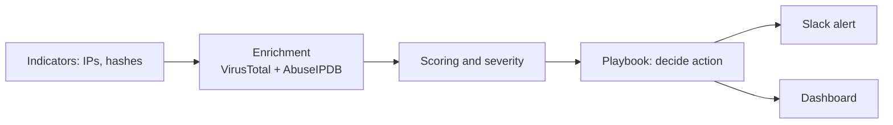

# AttackLens Auto: Security Orchestration, Automation and Response (SOAR) Playbook

The automation counterpart to [AttackLens](https://github.com/JayPatel199/attacklens) (detection) and [AttackLens Red](https://github.com/JayPatel199/AttackLens-Red) (attack simulation). This project automatically enriches threat indicators, scores them, decides a response action, and sends real-time alerts, simulating how a SOAR platform (like Splunk SOAR or Tines) reduces manual analyst work.

## Results at a glance
- 5 indicators (IPs and file hashes) automatically enriched via VirusTotal and AbuseIPDB
- A scoring and severity engine (clean / low / medium / high / critical)
- A playbook that auto-approves actions for critical/clean cases and flags high-severity ones for human review
- Real-time Slack alerting for medium severity and above
- An interactive dashboard showing the full pipeline per indicator

## How it works


## Example decision
| Indicator | Type | Severity | Score | Action |
|---|---|---|---|---|
| 185.220.101.45 | IP (known Tor exit node) | critical | 255 | Block IP at perimeter firewall (auto-approved) |
| 44d88612fea8a8f36de82e1278abb02f | Hash (EICAR test file) | critical | 640 | Quarantine file on all endpoints (auto-approved) |
| 8.8.8.8 | IP (Google DNS) | clean | 0 | No action |

## Tools used
Python, VirusTotal API, AbuseIPDB API, Slack Incoming Webhooks, Streamlit, python-dotenv.

## How to run it yourself
```bash
git clone https://github.com/JayPatel199/AttackLens-Auto.git
cd AttackLens-Auto
pip install requests python-dotenv pandas streamlit
# Create a .env file with VT_API_KEY, ABUSEIPDB_API_KEY, SLACK_WEBHOOK_URL
python enrich.py
python playbook.py
python alert.py
streamlit run app.py
```

## Part of the AttackLens series
| Project | Focus |
|---|---|
| [AttackLens](https://github.com/JayPatel199/attacklens) | Blue team: detection engineering, MITRE ATT&CK |
| [AttackLens Red](https://github.com/JayPatel199/AttackLens-Red) | Red team: web attack simulation |
| AttackLens Auto (this repo) | Automation: enrichment, triage, simulated response |

## Limitations and next steps
- Response actions are simulated and logged, not executed against real infrastructure, since this is a personal lab project
- VirusTotal's free tier is rate-limited to 4 requests/minute, which the script respects with built-in delays
- Next: feed AttackLens's real detection alerts into this pipeline automatically, closing the loop between detection and response

Author: Jay Patel
